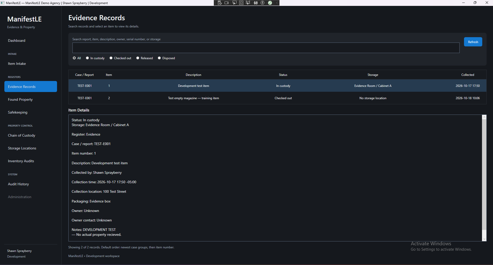
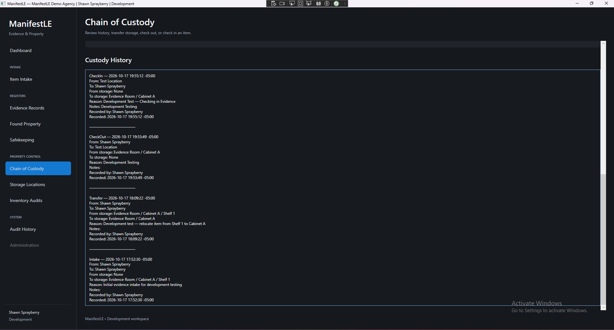
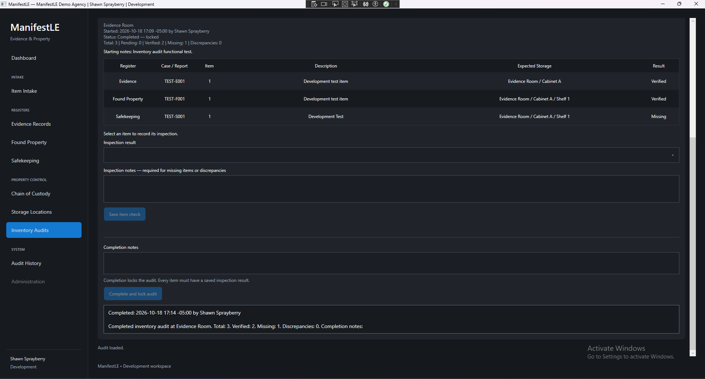

# ManifestLE

A Windows desktop evidence and property management prototype built with C#, WPF, Entity Framework Core, and SQLite.

ManifestLE supports property intake, item-level custody tracking, storage verification, and searchable application activity.

**Status:** Active development  
**Tests:** 43 passing automated tests, verified October 18, 2026

## Screenshots

Screenshots show fictional development data.

### Evidence Records

Separate property items grouped by case, with custody status and storage details.



### Chain of Custody

Item-level history showing intake, transfers, check-outs, and check-ins.



### Inventory Audits

Completed storage audit showing verified and missing items, with inspection controls locked.



## Features

### Authentication

- Initial agency and administrator setup
- Username and password authentication
- Authenticator-based MFA
- Login attempt tracking and temporary lockout
- Role checks for restricted operations

### Property Management

- Separate registers for evidence, found property, and safekeeping
- Multiple individually numbered items under one case or report
- Intake with collection, packaging, and storage information
- Hierarchical storage locations
- Searchable registers with status filters
- Natural item-number sorting within case groups

### Chain of Custody

- Storage transfers
- Check-out and check-in
- Individual custody histories for each property item
- Transactional saves of property state, custody events, and audit entries

### Inventory Audits

- Storage-location audits with optional child locations
- Snapshots of expected property when an audit starts
- Verified, Missing, and Discrepancy findings
- Saved inspection notes and progress
- Completed audits locked against changes through the application service
- Investigation and resolution services with automated tests; interface integration is in progress

### Audit History

- Search by case/report, item, user, action, or record type
- Filters for authentication, intake, custody, inventory audits, and setup
- Readable action and record-type labels
- Oldest-first and newest-first ordering
- Timelines for individual inventory audits

## Technology

- C# and .NET 10
- Windows Presentation Foundation (WPF)
- Entity Framework Core
- SQLite
- xUnit
- Otp.NET
- QRCoder
- Windows Data Protection API for local MFA secret protection

## Solution Structure

| Project | Responsibility |
|---|---|
| ManifestLE.App | WPF screens and application navigation |
| ManifestLE.Core | Domain models and enums |
| ManifestLE.Infrastructure | Database configuration, migrations, and services |
| ManifestLE.Tests | Automated service and password tests |

## Automated Tests

The current suite contains 43 passing test cases covering:

- Password hashing and verification
- Custody movement validation and permissions
- Inventory audit snapshots and storage scope
- Required notes for audit findings
- Stale inspection updates
- Completed-audit locking through services
- Follow-up permissions and resolution rules
- Preservation of original audit findings

Database-backed tests use isolated SQLite databases in memory rather than the application's development database.

## Getting Started

### Requirements

- Windows
- .NET 10 SDK
- Visual Studio with .NET desktop development support

### Setup

1. Clone the repository.
2. Open `ManifestLE.slnx` in Visual Studio.
3. Restore NuGet packages.
4. Set `ManifestLE.App` as the startup project.
5. Open **Tools → NuGet Package Manager → Package Manager Console**.
6. Apply the database migrations:

   ```powershell
   Update-Database -Project ManifestLE.Infrastructure -StartupProject ManifestLE.App
   ```

7. Build and run the application.
8. Complete agency setup, create the initial administrator, and enroll an authenticator.

Use fictional agency and property information for evaluation.

Authenticator codes require an accurately synchronized system clock.

### Run Tests

Use **Test → Test Explorer → Run All Tests** in Visual Studio.

Alternatively, from the solution folder:

```powershell
dotnet test ManifestLE.Tests/ManifestLE.Tests.csproj
```

## Development Database

The development database is stored outside the source folder at:

```text
%LOCALAPPDATA%\ManifestLE\Development\manifestle-development.db
```

Do not commit local databases, passwords, MFA enrollment secrets, or recovery material.

## Current Limitations

ManifestLE is a development prototype, not a production-ready evidence management system.

- The database configuration targets local development.
- MFA secret protection is tied to the Windows user account.
- Multi-station deployment, backup and recovery workflows, and production security review remain future work.
- Audit History currently loads records into memory.
- Discrepancy follow-up controls are not yet connected to the interface.
- Application audit logging is not a tamper-evident logging system.

## Development Roadmap

- Complete discrepancy follow-up screens
- Expand user administration
- Add property release and disposal workflows
- Add barcode and label support
- Add reporting and export tools
- Improve database query scalability
- Develop deployment and recovery procedures

## Author

Shawn Sprayberry